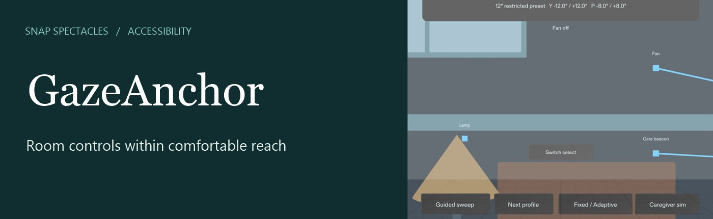
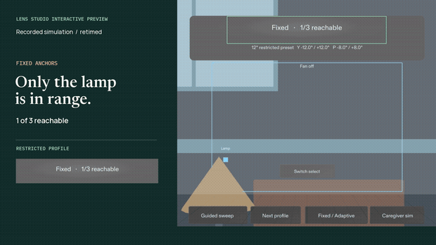
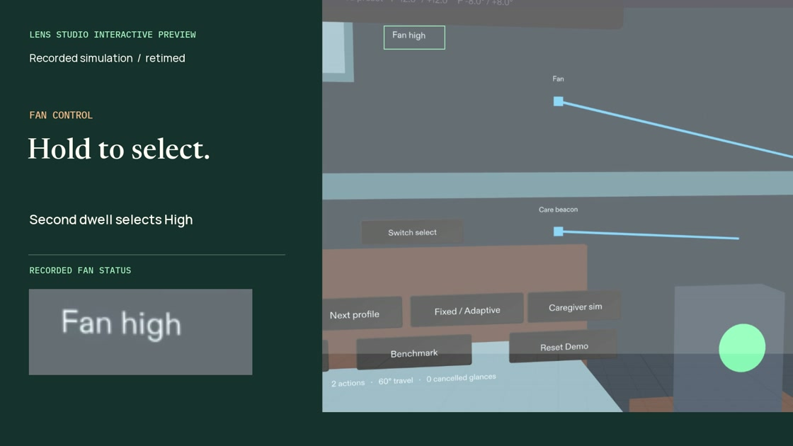
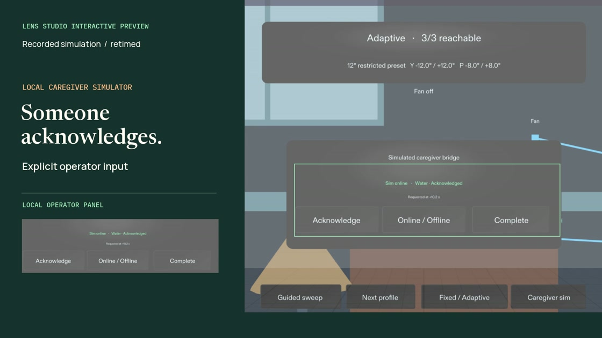
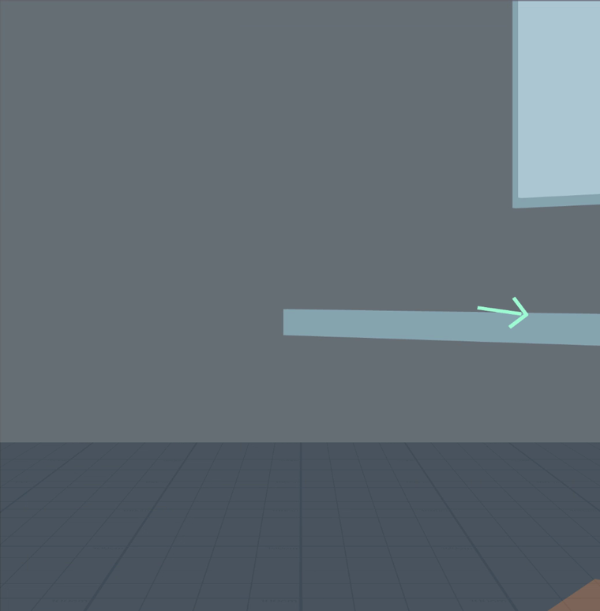
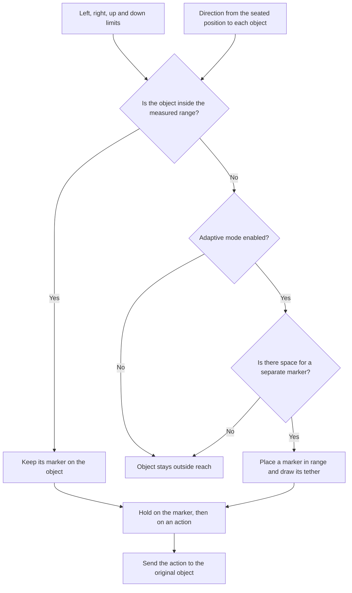
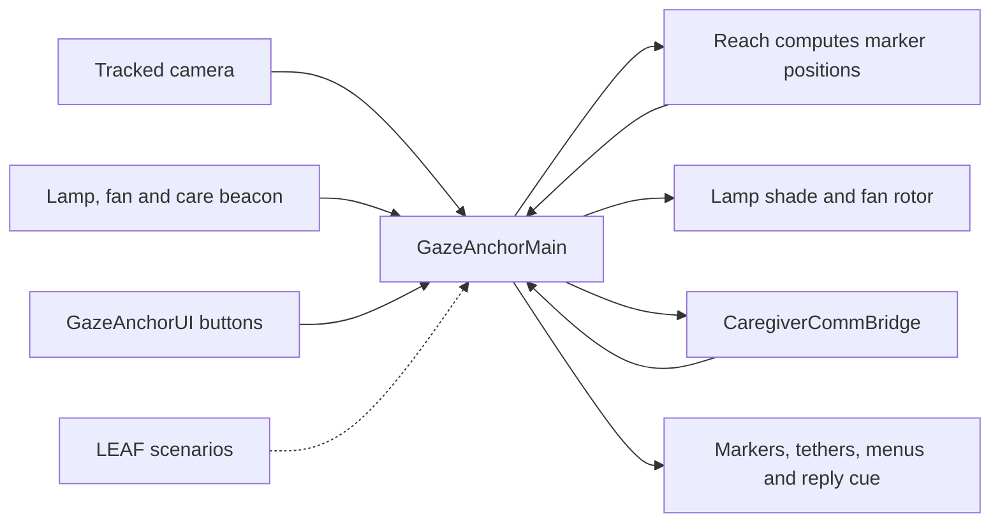
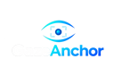

<p align="center">
  
</p>

<p align="center">
  
  
  
  
</p>

<p align="center">
  <b><a href="https://youtu.be/TXR-9WyQL4g">▶ Watch the demo video · 2:55</a></b>
</p>

<p align="center">
  <a href="#the-fan-is-just-out-of-reach">The problem</a> ·
  <a href="#what-gazeanchor-does">What it does</a> ·
  <a href="#a-walk-through-the-lens">Walk-through</a> ·
  <a href="#how-it-thinks">How it thinks</a> ·
  <a href="#architecture">Architecture</a> ·
  <a href="#why-glasses">Why glasses</a> ·
  <a href="#what-it-cannot-do-yet">Limits</a> ·
  <a href="#run-it">Run it</a>
</p>

---

## The fan is just out of reach

You're sitting by the bed. You can turn your head far enough to see the lamp. The fan is farther to your right. If a pair of glasses puts the fan's button directly on the fan, turning it up still takes a movement you can't comfortably make.

In GazeAnchor's room, the lamp is about 10° left of center. The fan is 34° to the right. For someone who can comfortably turn 12° either way, where should the fan button go?

**GazeAnchor puts a second control where the wearer can reach it.** A blue line connects that control to the fan. Hold your head on the nearby square, choose **High**, and the blades turn faster across the room.

<sub>The room, appliances, and caregiver panel are simulated in Lens Studio. The angles and task counts below come from recorded Preview runs.</sub>

## What GazeAnchor does

1. **Measure a comfortable turn.** From a seated position, use **Guided sweep** to look left, right, up, and down. Capture each direction, then hold at neutral for two seconds. Someone who turns farther left than right gets a range that reflects that difference.
2. **Bring the controls into reach.** In **Fixed**, each marker sits on its object. Switch to **Adaptive**. The lamp keeps its marker. The fan and care beacon gain separate blue squares inside the wearer's range, each with a line back to its object.
3. **Operate the room.** Aim your head at a square until the ring fills. Hold on a choice to act. The lamp has On, Dim, and Off. The fan has High, Low, and Off.
4. **Ask for help.** Choose **Care beacon → Water**. The wearer sees *Delivered* when the local panel receives it. *Acknowledged* appears when the operator presses the button. Reposition, Temperature, and Assistance are also available.

### Three promises

- **A glance is safe to abandon.** Looking away while the ring is filling cancels the selection. In Preview, a 450 ms glance left the lamp untouched.
- **A control keeps its identity.** Follow either blue line and it leads back to the object that will respond. The two tethered markers were 16.28 cm apart in the placement test.
- **The count reflects what fits.** If the measured range is too small to keep markers apart, the Lens reports fewer reachable controls. It keeps the movement limits the wearer supplied.

## A walk through the Lens

<p align="center">
  
  <br><sub><b>From the seated view to an acknowledged request.</b> Excerpts from the demonstration, in order.</sub>
</p>

<p align="center">
  
  <br><sub><b>Read the blue squares.</b> The upper square controls the fan. The lower one opens care requests. Both lines continue to the right, toward objects outside this view.</sub>
</p>

<table>
<tr>
<td width="50%"><br><b>Start at the bedside.</b> With the restricted preset, the lamp is the only control inside a 12° turn to either side.</td>
<td width="50%"><br><b>Measure each direction.</b> This separate sweep captured 12° left, 11° right, 8° up, and 7° down. All three controls fit.</td>
</tr>
<tr>
<td><br><b>Turn up the fan.</b> The second hold selects High. The status changes and the rotor speeds up at the fan's original position.</td>
<td><br><b>Ask for water.</b> The wearer can use the simulated switch to select the focused item and navigate the action choices.</td>
</tr>
<tr>
<td><br><b>Receive a reply.</b> Delivery leaves the request open. The operator acknowledges it and can later mark it complete.</td>
<td><br><b>Find the reply.</b> If the wearer is looking away when the operator acknowledges, the arrow points back. Looking toward the beacon clears it.</td>
</tr>
</table>

| Step | What you see | What you do |
| --- | --- | --- |
| Start the comparison | **Fixed · 1/3 reachable** | Choose **Reset Demo**, face forward, and start **Benchmark**. Turn on the lamp. Try the other markers within the preset limits, then press **Benchmark** to end the attempt. |
| Repeat from the same seat | **Adaptive · 3/3 reachable** | Reset, switch to **Adaptive**, and start **Benchmark** again. Keep the same preset and seated position. |
| Finish the tasks | Lamp on, fan spinning, water request delivered | Select **Lamp → On**, **Fan → High**, then **Care beacon → Water**. |
| Close the loop | **Water · Acknowledged** and three tasks completed | Open **Caregiver sim** and press **Acknowledge**. The trial ends automatically. |

## How it thinks



**Check it against the room.** With a 12° rightward limit, the outermost candidate for a tethered marker is 10.2° right (0.85 × 12°). That brings a control for the fan at 34° within a comfortable turn. [Placement code](Assets/Scripts/Reach.ts)

### Where each choice comes from

| Decision | Why |
| --- | --- |
| Record four limits separately | A comfortable turn can differ left to right and up to down. |
| Keep reachable controls on their objects | The wearer already knows where the lamp is. Moving its marker would make them find it again. |
| Fit new markers within 85% of the range | Leave room at the edge of a turn. The solver also keeps new markers at least 9° apart in its yaw/pitch grid and clear of the central 4.5° on either side. |
| Position the action menu inside the range | Reaching **Fan** is only useful if the wearer can also reach **High**. |
| Require an explicit caregiver reply | A delivered request says the panel received it. Only the operator can acknowledge or complete it. |

## Architecture



| Layer | Built with |
| --- | --- |
| Platform | Lens Studio 5.23.2, Snap Spectacles target, SPECS 27 Interactive Preview |
| Language and input | TypeScript, camera-forward head pointing, Spectacles Interaction Kit, simulated switch |
| Interface | Spectacles UI Kit buttons, scene markers, tether lines, dwell ring |
| Verification | LEAF 2.0.0 in Preview and Node.js standalone tests |

### Scripts

| File | Job |
| --- | --- |
| [GazeAnchorMain.ts](Assets/Scripts/GazeAnchorMain.ts) | Reads head direction, runs calibration and dwell, applies room actions, and records benchmark trials. |
| [Reach.ts](Assets/Scripts/Reach.ts) | Checks angular bounds, finds separated positions, and measures camera rotation. |
| [GazeAnchorUI.ts](Assets/Scripts/GazeAnchorUI.ts) | Builds the panels, buttons, and labels. |
| [CaregiverCommBridge.ts](Assets/Scripts/room/CaregiverCommBridge.ts) | Tracks requests through delivery, offline failure, retry, acknowledgment, and completion. |
| [LeafIndex.ts](Assets/Scripts/tests/LeafIndex.ts) | Registers the Preview scenarios. |

## Why glasses

| Strength of glasses | How GazeAnchor uses it |
| --- | --- |
| They turn with your head | The same movement the wearer calibrates becomes the input for aiming at a control. |
| They can draw beside a room object | The lamp owns its marker. The fan can have a nearby control while a visible line still identifies the appliance across the room. |
| They leave your hands free | Two holds are enough to turn the lamp on or ask for water. The wearer can stay seated and silent. |

## Done criteria and tests

**12 of 12 LEAF scenarios passed** in the recorded Lens Studio Preview run. The restricted benchmark used the same synthetic head limits in both modes (±12° horizontally, ±8° vertically). [Preview log](devpost/evidence/preview-results.txt)

| Recorded result | Fixed | Adaptive |
| --- | ---: | ---: |
| Reachable controls | 1/3 | 3/3 |
| Tasks completed | 1/3 | 3/3 |
| Trial duration | 4.69 s, stopped after lamp | 7.48 s, all tasks complete |
| Total camera rotation | 48.94° | 77.28° |

The Adaptive run included two additional tasks. These timings describe different amounts of completed work. [Benchmark protocol](devpost/benchmark-results.md)

| Criterion | Scenarios | What passed |
| --- | --- | --- |
| Calibration and placement | T01–T02 | Measured asymmetric limits, stationary lamp, two distinct tethered markers. |
| Intentional selection | T03–T07 | Brief glance, jitter, dwell duration, overlapping targets, and cancellation before a command. |
| Care requests | T08–T09 | Delivery waited for acknowledgment. Reconnecting after a failure required an explicit retry. |
| Tracking recovery | T10 | An interruption cleared a partial hold. A fresh hold worked after recovery. |
| Room tasks and feedback | T11–T12 | Fixed and Adaptive task counts, fan speeds, switch selection, and a reply arrow that cleared on return. |

### Logic proven, feel unproven

| Checked in Preview | Still to test with wearers and hardware |
| --- | --- |
| Which controls fit a measured range | Whether calibration stays comfortable over repeated use |
| Dwell behavior with simulated jitter | How reliably an individual can hold on a target while wearing the glasses |
| Reply arrow appears, chime is requested | How easily the wearer notices the cue in a real room |

## What it cannot do yet

- **Room control is simulated.** The lamp and fan respond inside the scene. Physical appliances would need a device connection.
- **Care requests stay local.** The caregiver panel runs in the Lens. Remote delivery and external switch hardware need integration.
- **Very small ranges can fit fewer controls.** Independent selection depends on enough space between targets.
- **Validation is Preview-based.** Sustained comfort, physical tracking, and speaker audibility are open questions. [Testing report](devpost/testing-report.md)

## Run it

1. Install **Git LFS** and **Lens Studio 5.23.2.26081320**. Fetch the project and its assets.

   ```sh
   git lfs install
   git clone https://github.com/SanTiwari07/GazeAnchor.git
   cd GazeAnchor
   git lfs pull
   ```

2. Open `GazeAnchor.esproj`. Select **SPECS 27** and start **Interactive** Preview.
3. Choose **Reset Demo**. Face the bedside lamp, switch to **Adaptive**, then aim at the upper blue square to try **Fan → High**.

| Control | Action |
| --- | --- |
| Right-drag | Turn the Preview camera to aim your head. |
| Hold on a marker or choice | Fill the ring to open a menu or confirm an action. |
| Click a panel button | Operate **Guided sweep**, **Fixed / Adaptive**, **Benchmark**, or **Caregiver sim**. |
| **Switch select** | Simulate switch input for the focused item and timed menu choices. |

For the recorded comparison, run **T11** in the LEAF panel. Run the standalone suite with `node --test tests/*.test.mjs` using Node.js 26. It covers 11 placement, rotation, and caregiver-state cases.

## How it was built

1. **Plan.** The Devpost Learn planning interview defined the seated use case, the tethered controls, and the three-task comparison. [Approved design brief](devpost/design-brief.md)
2. **Build.** The team used CLAD and the Lens Studio MCP to implement the Lens in the authored room. [Engineering report](devpost/engineering-report.md)
3. **Verify.** The team reopened the saved project, ran the Preview scenarios, and recorded the wearer and caregiver interactions. [Build verification](devpost/build-verification.md) · [44-second video overview](https://youtube.com/shorts/jcPbjKkYRo4)

## Team

Built by [Shambhavi Patil](https://github.com/Shambhavi500) and [Sanskar Tiwari](https://github.com/SanTiwari07).

## Disclosure

The team's original GazeAnchor code is available under the [MIT License](LICENSE). Snap packages, other third-party assets, and the Devpost planning skill retain their own terms. [Bundled packages](Packages/) · [Devpost skill license](agent/skills/plan-lens/LICENSE)

## Sources

- Calibrating the interface to the wearer's movement draws on [Ability-Based Design](https://doi.org/10.1145/1952383.1952384).
- Linking a reachable control to its distant object draws on [Reality Proxy](https://doi.org/10.1145/3746059.3747709).

<p align="center"><br><br><sub><b>GazeAnchor</b> · Room controls within comfortable reach.</sub></p>
