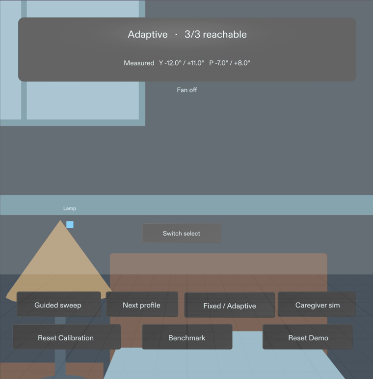
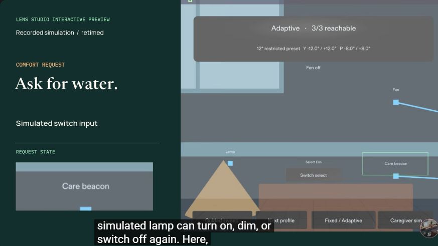

# GazeAnchor


A lamp is straight ahead. The fan is farther to the side than a seated wearer can comfortably turn. GazeAnchor leaves the lamp control where it is and brings a second control for the fan into view. A thin line leads back to the fan so the wearer can see what they are about to change.

Built for Snap Spectacles, the Lens uses head direction and a steady hold to operate a simulated lamp, change fan speed, or send a comfort request. In the recorded restricted-range trial, the wearer could reach **one of three controls in Fixed mode and all three in Adaptive mode**.

[Watch the full demonstration](https://youtu.be/TXR-9WyQL4g) · [Watch the YouTube Short](https://youtube.com/shorts/jcPbjKkYRo4?feature=share) · [Run the Lens](#run-the-lens) · [Preview results](#preview-results)

## What changes when reach changes?

| Fixed placement | Adaptive placement |
| --- | --- |
|  |  |
| The controls stay on the lamp, fan and Care beacon. Only the lamp falls inside the restricted range. | The lamp stays put. Tethered controls bring the fan and Care beacon inside the measured range. |

**Calibrate.** From a seated neutral position, the wearer looks comfortably left, right, up and down, then holds steady for two seconds. Each limit is recorded separately, so a wearer can have more reach on one side.

**Select.** Hold head direction on a marker to open its actions. Hold again on an action, such as **Fan → High**, to apply it. Moving away cancels a dwell in progress. After selection, the wearer must release focus before repeating the command. The **Switch select** button also supports focused selection and timed scanning in Preview.

**Request care.** Select **Water**, **Reposition**, **Temperature** or **Assistance**. A delivered request waits for acknowledgment from the local caregiver panel. If the panel is offline, the failed request can be retried. When acknowledgment arrives outside the wearer's view, an arrow points back toward the Care beacon.

[](https://youtu.be/TXR-9WyQL4g?t=100)

*From the recorded demonstration. The square on the lamp stays with the appliance while the wearer can select the nearby Care beacon.*

[Inspect the control tethers](devpost/evidence/adaptive-tethers.png) · [See the off-view acknowledgment cue](devpost/evidence/off-view-cue.png)

## Run the Lens

Install Git LFS and Lens Studio **5.23.2.26081320**. Fetch the large assets before opening the project.

```sh
git lfs install
git clone https://github.com/SanTiwari07/GazeAnchor.git
cd GazeAnchor
git lfs pull
```

1. Open `GazeAnchor.esproj` and select **SPECS 27 Interactive** in Preview. Right-drag to look around and click to simulate a pinch.
2. Select **Reset Demo** for the restricted preset in Fixed mode. Check which room controls are reachable. To measure a fresh range, choose **Guided sweep** and follow the four directions and neutral hold.
3. Toggle **Fixed / Adaptive**. Find the lamp, fan and Care beacon, then follow each tether back to its room object.
4. Turn the lamp on, set the fan to high and request water. Open **Caregiver sim** to acknowledge the request. To reproduce the measured trial, select **Benchmark** from neutral before the first action. Press it again to end an incomplete trial.

## Preview results

The recorded benchmark used the same restricted movement profile and task sequence in both modes. LEAF supplied synthetic head poses through the Preview camera.

| Measurement | Fixed | Adaptive |
| --- | ---: | ---: |
| Reachable controls | 1 of 3 | 3 of 3 |
| Completed tasks | 1 of 3 | 3 of 3 |
| Trial duration | 4.69 s, stopped incomplete | 7.48 s, all tasks completed |
| Total camera rotation | 48.94° | 77.28° |
| Duplicate commands | 0 | 0 |

The two durations cover different amounts of work. The result demonstrates improved reachability in this simulated room. Physical comfort, real-device tracking, paired appliances, hardware switches and remote caregiver delivery still need evaluation.

The project records **12 passing LEAF scenarios** and **11 passing standalone tests**. Run `node --test tests/*.test.mjs` with Node.js 26 for the standalone suite. For integrated scenarios, run the registered GazeAnchor tests one at a time in the Preview LEAF panel (Leaf 2.0.0).

[Benchmark protocol and results](devpost/benchmark-results.md) · [Preview log](devpost/evidence/preview-results.txt) · [Testing report](devpost/testing-report.md)

## Inside the project

| Entry point | Responsibility |
| --- | --- |
| [Room scene](Assets/Scene.scene) | Room geometry, camera and interaction bindings |
| [Lens controller](Assets/Scripts/GazeAnchorMain.ts) | Calibration, dwell input, room actions and benchmark telemetry |
| [Reach calculations](Assets/Scripts/Reach.ts) | Checks movement limits and places separated proxy controls |
| [Spatial UI](Assets/Scripts/GazeAnchorUI.ts) | Builds the controls and labels visible in the room |
| [Caregiver bridge](Assets/Scripts/room/CaregiverCommBridge.ts) | Tracks local delivery, failure, retry and acknowledgment |
| [Preview scenarios](Assets/Scripts/tests/) | Exercises the Lens through simulated wearer and operator input |

## Design and credits

Built by [Shambhavi Patil](https://github.com/Shambhavi500) and [Sanskar Tiwari](https://github.com/SanTiwari07) for Learn AR with SPECS Round 2. The project uses Snap’s Spectacles Interaction Kit, Spectacles UI Kit and LEAF. These components retain their upstream terms.

The calibration design draws on [Ability-Based Design](https://doi.org/10.1145/1952383.1952384), and the object-linked controls draw on [Reality Proxy](https://doi.org/10.1145/3746059.3747709). The team’s design decisions and build evidence are available in the [design brief](devpost/design-brief.md), [planning documents](docs/planning/README.md), [build verification](devpost/build-verification.md) and [submission checklist](devpost/submission-checklist.md).
